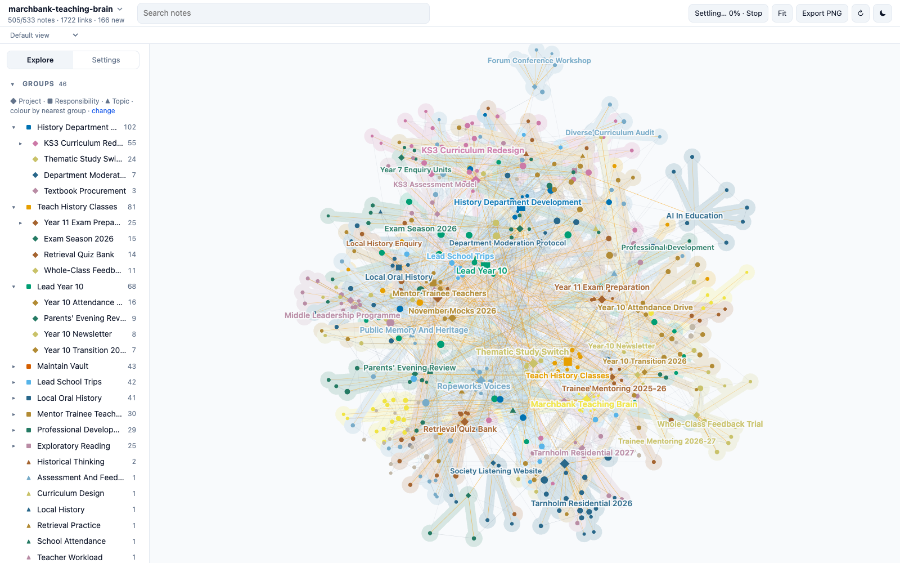

# Marchbank Teaching Brain

A demo Second Brain: about 530 linked Markdown notes holding the working memory of a fictional secondary-school history teacher who is also head of Year 10. Clone it, open the folder, and explore what a vault looks like after two years of daily use: classes, a curriculum change, pastoral work, a residential trip, a trainee, meetings, people, reading, open questions, and the links between them.



**[Explore this vault in the live demo](https://mfoll.github.io/brain-graph-demo/?vault=marchbank-teaching-brain)**: its map in Brain Graph, in your browser, with nothing to install.

> [!warning]
> Everything about the school is fictional: Corrandale School, the Wyvernmoor Learning Trust, the Merrow Examinations Board, the town, the ropeworks, every person, class, trip and result. Any resemblance to real people or organisations is accidental. Only the Sources marked as Wikipedia articles, scientific papers or web pages are real.

## Everyday use

Try “Save this useful idea or reference under the relevant project”, “Where did we leave this project?” or “Update what we decided and what comes next”. Inspect what was saved and find it again from the Project. The [template’s practical walkthrough](https://github.com/mfoll/second-brain-template#build-your-first-useful-project) explains how to start your own vault; experiment on a private copy if you want to keep real notes.

Inbox processing is optional deferred capture. Process Inbox handles the requested scope; Ready Ingestion selects only `ingest_ready: true` before following the same processing. A supplied external source can go directly through Ingest Source. Neither an Inbox, Tolaria nor an integration is required. Lint checks structure; health review judges usefulness. The deliberate findings described in this demo remain examples, not defects to repair automatically.

## What it shows

The vault was deployed from the [Second Brain template](https://github.com/mfoll/second-brain-template), which adds operating rules, workflows and a decision record to the [Portent](https://github.com/refactoringhq/portent) note model. Everything is plain files: Markdown notes with YAML frontmatter, typed relationships (`belongs_to`, `related_to`, `has`) and wikilinks. No app, database or index is required.

| Area | What to look at |
| --- | --- |
| Structure | 8 Responsibilities at the root, about 26 Projects under them, 10 Topics as lateral context; every note rolls up to a Responsibility. |
| Memory | About 180 Sources, 50 Events, 35 Questions, 30 Concepts, 15 Opinions, 16 Recaps, 40 people. |
| Real material | About 60 Sources are real Wikipedia articles and open-access papers on teaching, assessment, attendance and the history taught, summarised in our own words. Their "Why It Matters" sections describe how the fictional teacher uses them. |
| Operations | `AGENTS.md`, Type notes, Procedures, Skills and ADRs from the template, unchanged except for the deployment steps. |
| History | Git history from January 2025 to October 2026, one commit for each month that had captures. |

## Open it

- **Any Markdown editor.** Clone the repository and open the folder; notes sit flat at the root by design. Start from [vault](vault.md).
- **[Tolaria](https://tolaria.md/).** Open the folder as a vault for typed sidebars, relationship panels and saved views.
- **[Brain Graph](https://github.com/mfoll/brain-graph).** See the whole vault as a map coloured by project:

  ```bash
  npx github:mfoll/brain-graph path/to/second-brain-demo-teacher
  ```

- **A coding agent.** Run Claude Code, Codex or Gemini CLI in the folder. They read [AGENTS](AGENTS.md) (through `CLAUDE.md` and `GEMINI.md` where needed) and follow the vault's Procedures.

## Try this

Each question has a known answer in the vault, so you can check what an agent finds.

| Ask | Where the answer lives |
| --- | --- |
| Which Year 10 classes are studying migration instead of medicine this year? | A department vote on 2026-02-04 switched every class; a meeting on 2026-05-13 cut it back to a pilot. See [thematic-study-switch](thematic-study-switch.md) and the daily Recap of 2026-05-13. |
| Did attendance decide who went on the Tarnholm trip? | A threshold was proposed and then dropped after an equity analysis. See [tarnholm-residential-2026](tarnholm-residential-2026.md) and [trip-places-equity-analysis](trip-places-equity-analysis.md). |
| Why do we double-mark a sample of mock papers? | A moderation meeting found the department marking generously. See [department-moderation-protocol](department-moderation-protocol.md) and [mock-moderation-2025-12-10](mock-moderation-2025-12-10.md). |
| Which ropeworks interviews can we use in Year 9 lessons? | It depends on which consent form each interviewee signed. See [ropeworks-voices](ropeworks-voices.md) and [ropeworks-consent-form-v2](ropeworks-consent-form-v2.md). |
| Can we use AI to mark the November mocks? | Still open, waiting on the trust's data protection review. See [can-we-use-ai-to-draft-feedback-on-mock-essays](can-we-use-ai-to-draft-feedback-on-mock-essays.md). |
| Why does every Key Stage 3 year start with timeline lessons? | A compromise with a colleague who still disagrees. See [ks3-curriculum-review-2025-06-25](ks3-curriculum-review-2025-06-25.md). |

Workflows to try with an agent:

- **Resume a project:** "Resume the Tarnholm Residential 2027."
- **Process the Inbox:** about eight raw captures from the last week of October 2026 have `_organized: false`; each has an obvious home.
- **Ingest a source:** give any Wikipedia article or open-access paper on feedback, attendance or oral history and ask where it belongs.
- **Lint the vault:** the audits should report one link to a missing note, one Person reached only through a Project's `has` list and one Concept that belongs to nothing, all left in on purpose. Informational lines, such as external contacts without a parent, are expected.

## Scope and privacy

The fictional teacher's classes, department work, head-of-year pastoral role, parent communication, school trips, trainee mentoring, professional development and volunteer oral history. Pupils are never named: they appear only as classes, tutor groups, counts or anonymised cases. Safeguarding details never enter the vault; notes point to the school's secure system through a Source note. No pupil-level marks, attendance records, credentials or personal administration.

## Template updates

The vault was deployed from the template on 2026-10-23. Later template improvements can be brought in with [Upgrade an Existing Vault From the Template](upgrade-existing-vault-from-template.md), as a reviewed change: an agent proposes each change, and a person approves it. Never run it unattended. A vault in use is expected to differ from the template on purpose, in its ADRs, Procedures, Skills and instructions.

## How it was made

An AI agent drafted the world specification (the school, people, projects, timeline and the storylines behind the questions above) and a person reviewed and changed it. AI agents then wrote the notes from it, one per area of the teacher's work, and retrieved the real articles and papers from Wikipedia and Europe PMC. The links, frontmatter, cross-area consistency and source metadata were checked with the template's lint scripts and against the original records.

## Storage and backup

The notes are plain files, and their history is this Git repository. To undo edits made while trying the demo, run `git checkout .`; `git clean -n` lists any new files, which `git clean -f` would delete.

## More example vaults

This is one of nine fictional vaults deployed from the same template, each kept by a different kind of person: a lab head, a café owner, a teacher, a freelance designer, a parent running a household, a sports club chair, a novelist, a start-up engineering lead and an HR assistant. The [template README](https://github.com/mfoll/second-brain-template#example-vaults) lists them all.

## Licence

MIT, see `LICENSE`, which also covers the template material. `THIRD_PARTY_NOTICES.txt` lists upstream notices. Cited articles and papers remain under their own licences; the notes contain only their metadata and our own summaries.
